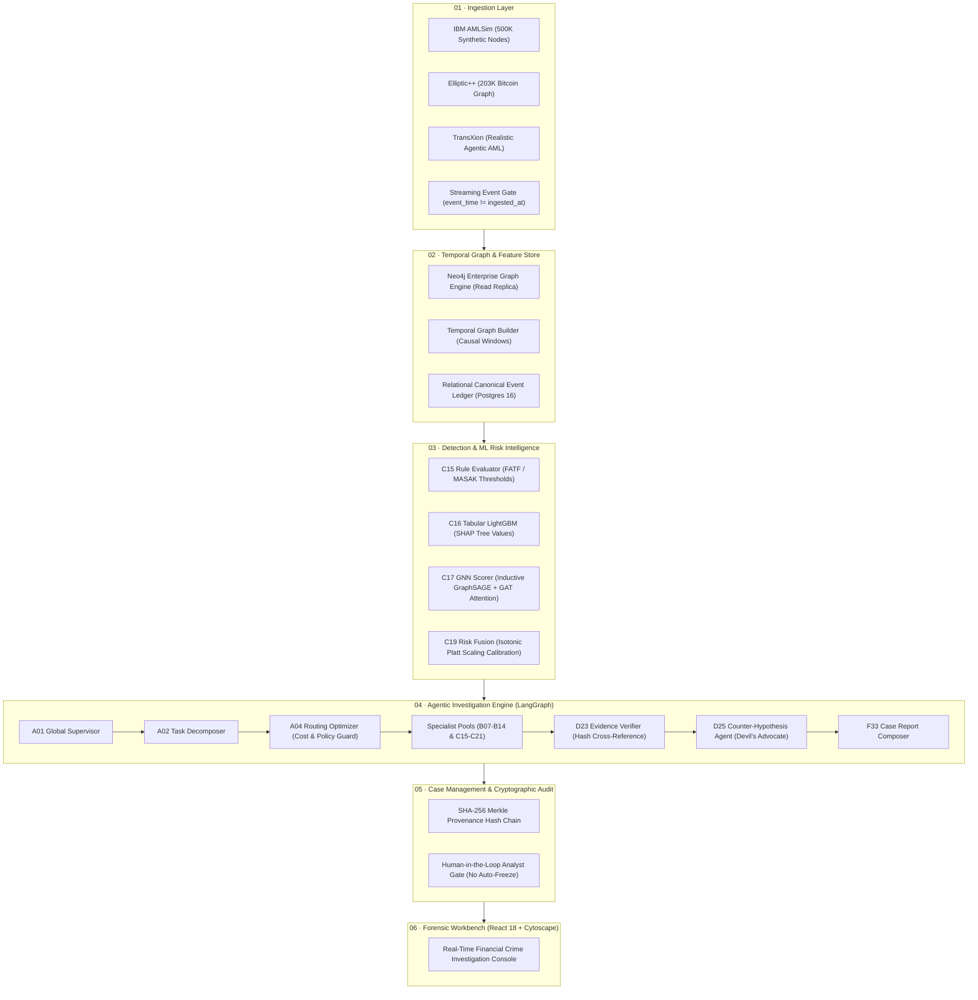

<div align="center">

# FraudGraph AI

### Enterprise Financial Crime Intelligence · Graph Machine Learning · Multi-Agent Investigation · Explainable AI

[](https://opensource.org/licenses/Apache-2.0)
[](https://www.typescriptlang.org/)
[](https://reactjs.org/)
[](https://vitejs.dev/)
[](https://neo4j.com/)
[](https://pyg.org/)
[](./src/tests)

<p align="center">
  <b>A graph-native, multi-agent financial crime intelligence platform engineered to bridge statistical machine learning, temporal graph neural networks, and 36 autonomous specialist investigator roles into human-auditable, evidence-grounded forensic case dossiers.</b>
</p>

[Key Capabilities](#key-capabilities) • [System Architecture](#system-architecture) • [36 Specialist Agents](#36-specialist-agent-roles) • [Empirical Benchmarks](#empirical-benchmark-matrix) • [Quick Start](#quick-start) • [Docker Deployment](#docker-compose-deployment) • [Research & Roadmap](#research-questions--roadmap)

---

</div>

## Executive Overview

Conventional Anti-Money Laundering (AML) and anti-fraud engines typically compute an opaque risk probability (e.g., `fraud_probability = 0.93`) without verifiable proof chains. This forces compliance officers and fraud investigators to spend hours manually querying relational tables, reconstructing transaction timelines, and reviewing thousands of false positives.

**FraudGraph AI** transforms financial crime investigation by unifying:
1. **Graph Neural Networks (PyG / GAT / GraphSAGE) & Tabular ML (LightGBM):** Extracts deep relational embeddings and behavioral signals from dynamic transaction networks.
2. **Multi-Agent Critical Investigation (36 Specialist Roles):** Employs dynamic task decomposition, adversary devil's advocates (counter-hypotheses), and proof grounding to evaluate competing explanations.
3. **Cryptographic Proof Vault & Explainable Altgraphs:** Formulates structured, cited forensic dossiers grounded in append-only SHA-256 Merkle hash chains, eliminating AI hallucinations and ensuring regulatory transparency.

---

## Key Capabilities

```
+----------------------------------------------------------------------------------------------------+
| 01. COMMAND CENTER         Executive telemetry, risk exposure (TRY, BTC, USD), alert trends        |
| 02. GRAPH EXPLORER         Interactive Cytoscape.js canvas, PageRank, Johnson cycle loops, halos  |
| 03. INVESTIGATION WORKBENCH 3-pane forensic desk, 6-stage lifecycle tracker, hypothesis evaluator  |
| 04. AGENT OPERATIONS       Live DAG orchestration pipeline, 36 specialist agents, token budgets    |
| 05. ALERT INTELLIGENCE     Automated multi-model anomaly triage, SLA timers, single-click escalate |
| 06. TRANSACTION INTELLIGENCE High-throughput stream auditor, layering/smurfing/peel-chain filters  |
| 07. EVIDENCE CENTER        Forensic artifact vault, SHA-256 proof chains, exportable JSON manifest |
| 08. RISK ANALYTICS         Interactive decision threshold tuning, PR-AUC 0.912, Brier score 0.042  |
| 09. MODEL INTELLIGENCE     Registry for LightGBM, GraphSAGE, GAT, SHAP feature drivers, PSI drift  |
| 10. DATASET REGISTRY       Multi-dataset adapters: IBM AMLSim, Elliptic++ Bitcoin, TransXion AML   |
| 11. COMPLIANCE & AUDIT     Immutable Merkle audit log, PII redaction guard, MASAK/FinCEN alignment |
| 12. SYSTEM ADMINISTRATION  Neo4j connection pool, Postgres WAL, Celery queues, LLM circuit breaker |
+----------------------------------------------------------------------------------------------------+
```

---

## System Architecture

FraudGraph AI is architected as an auditable six-layer modular intelligence system:



---

## 36 Specialist Agent Roles

FraudGraph AI features 36 strictly typed specialist agent contracts across 6 functional domains. Every agent operates under constrained tool allowlists, budget boundaries, and verifiable input/output contracts.

<details>
<summary><b>Group A — Orchestration and Case Management (6 Agents)</b></summary>

| ID | Name | Role | Primary Allowed Tools | Output Contract |
| :---: | :--- | :--- | :--- | :--- |
| **A01** | Global Supervisor | Root Coordinator | `plan_evaluator`, `agent_dispatcher`, `budget_guard` | `InvestigationRoadmap` |
| **A02** | Task Decomposer | Hierarchical Partitioning | `dag_builder`, `dependency_analyzer` | `AtomicTaskList[]` |
| **A03** | Investigation Planner | Evidence Strategy | `typology_matcher`, `evidence_graph_matrix` | `PrioritizedPlan` |
| **A04** | Routing Optimizer | Dynamic Dispatcher | `cost_model_evaluator`, `latency_budget_checker` | `AgentRoutingTable` |
| **A05** | Budget Controller | Cost & Token Enforcer | `token_tracker`, `circuit_breaker` ($1.50 cap) | `BudgetAuthorizationStatus` |
| **A06** | Case Lifecycle Agent | State Transition Manager | `postgres_case_repo`, `audit_sign` | `NewCaseState` |

</details>

<details>
<summary><b>Group B — Transaction and Graph Intelligence (8 Agents)</b></summary>

| ID | Name | Role | Primary Allowed Tools | Output Contract |
| :---: | :--- | :--- | :--- | :--- |
| **B07** | Transaction Analyst | Flow Inspector | `read_tx_ledger`, `velocity_calculator` | `TransactionAnomalySummary` |
| **B08** | Account Behavior Analyst | Baseline Deviation | `profile_feature_store`, `historical_quantile_calc` | `BehaviorDeviationVector` |
| **B09** | Temporal Pattern Analyst | Time-Series Miner | `fourier_periodicity`, `burst_detector` | `TemporalClusteringReport` |
| **B10** | Graph Structure Analyst | Centrality Miner | `neo4j_readonly_cypher`, `pagerank_calc` | `SubgraphTopologyMetrics` |
| **B11** | Community Detection Agent | Cluster Partitioner | `louvain_clustering`, `weakly_connected_components`| `ClusterPartitionMap` |
| **B12** | Circular Flow Analyst | Loop & Cycle Detector | `johnson_cycles_finder`, `fund_conservation_check` | `DetectedCyclesList` |
| **B13** | Multi-Hop Flow Analyst | Layering Tracer | `shortest_path_dijkstra`, `flow_conservation_tracer`| `MultiHopChains` |
| **B14** | Entity Resolution Agent | Deduplication & Aliases | `fuzzy_string_matcher`, `ip_device_matcher` | `MergedEntityClusters` |

</details>

<details>
<summary><b>Group C — Machine Learning and Risk (7 Agents)</b></summary>

| ID | Name | Role | Primary Allowed Tools | Output Contract |
| :---: | :--- | :--- | :--- | :--- |
| **C15** | Rule Evaluation Agent | Rule Engine | `aml_ruleset_runner` | `TriggeredRules[]` |
| **C16** | Tabular ML Analyst | LightGBM Inference | `lightgbm_infer`, `shap_values_calc` | `RiskProbability & SHAP` |
| **C17** | GNN Analyst | Graph Neural Scorer | `graphsage_torch_infer`, `gat_attention_weights` | `GraphEmbedding & Risk` |
| **C18** | Anomaly Analyst | Outlier Scorer | `isolation_forest`, `autoencoder_reconstruction` | `AnomalyScore` |
| **C19** | Risk Fusion Agent | Signal Calibrator | `isotonic_calibrator`, `platt_scaler`, `bayesian_fusion`| `CalibratedRiskScore` |
| **C20** | Uncertainty Analyst | Epistemic Uncertainty | `conformal_prediction_set`, `mc_dropout` | `AbstainRecommendation` |
| **C21** | Drift Detection Agent | Drift Monitor | `population_stability_index`, `ks_test` | `DriftMetrics & RetrainAlert` |

</details>

<details>
<summary><b>Group D — Evidence and Critical Investigation (7 Agents)</b></summary>

| ID | Name | Role | Primary Allowed Tools | Output Contract |
| :---: | :--- | :--- | :--- | :--- |
| **D22** | Evidence Collector | Artifact Harvester | `hash_sha256`, `subgraph_snapshot_serializer` | `EvidenceRecord (EV-*)` |
| **D23** | Evidence Verifier | Grounding Validator | `evidence_claim_crossref`, `source_hash_auditor` | `VerificationStatus` |
| **D24** | Hypothesis Generator | Theory Formulation | `typology_kb_retriever`, `scenario_generator` | `CandidateHypotheses[]` |
| **D25** | Counter-Hypothesis Agent | Devil's Advocate | `business_explanations_kb`, `counter_evidence_finder`| `AlternativeExplanations[]` |
| **D26** | Contradiction Detector | Inconsistency Finder| `nli_entailment_checker`, `temporal_overlap_validator`| `ContradictionPairs[]` |
| **D27** | Graph Explanation Agent | Visual Narrative | `gnn_explainer_subgraph`, `cytoscape_json_exporter`| `AuditableExplanationSubgraph`|
| **D28** | Confidence Reviewer | Final Arbiter | `calibrated_threshold_gate` | `VerdictRecommendation` |

</details>

<details>
<summary><b>Group E — Compliance and Security (4 Agents)</b></summary>

| ID | Name | Role | Primary Allowed Tools | Output Contract |
| :---: | :--- | :--- | :--- | :--- |
| **E29** | Policy Interpreter | Policy Alignor | `policy_handbook_rag` | `ApplicableSOPRules[]` |
| **E30** | Compliance Review Agent | Checklist Validator | `fincen_masak_checklist_runner` | `ComplianceChecklistStatus` |
| **E31** | Privacy Guardian | PII Redactor & Tokenizer| `presidio_pii_anonymizer`, `token_hasher` | `AnonymizedDossier` |
| **E32** | Audit Integrity Agent | Immutable Trace Signer | `merkle_hash_chain`, `trace_signature_validator` | `IntegrityVerificationProof` |

</details>

<details>
<summary><b>Group F — Reporting and Continuous Learning (4 Agents)</b></summary>

| ID | Name | Role | Primary Allowed Tools | Output Contract |
| :---: | :--- | :--- | :--- | :--- |
| **F33** | Case Report Composer | Forensic Dossier Author | `pdf_markdown_generator`, `evidence_citation_linker` | `ExportableCaseDossier` |
| **F34** | Analyst Assistant | Interactive Q&A Co-Pilot| `case_vector_search`, `cypher_generator_sandboxed` | `GroundingAnswer` |
| **F35** | Feedback Learning Agent | Disposition Classifier | `disposition_categorizer`, `preference_dataset_writer`| `TrainingPair` |
| **F36** | Evaluation Agent | Benchmark Evaluator | `ground_truth_comparator`, `precision_recall_scorer` | `BenchmarkReportMatrix` |

</details>

*For full JSON schemas, allowed tool signatures, and failure fallbacks, see [`docs/AGENT_CATALOG.md`](./docs/AGENT_CATALOG.md).*

---

## Empirical Benchmark Matrix

FraudGraph AI models and baseline heuristics were evaluated across identical temporal train/test splits (50,000 transactions, 2,056 ground-truth fraud instances) using IBM AMLSim and TransXion datasets:

| Architecture | Model Family | PR-AUC | Recall@100 | Precision@100 | Brier Calibration | p95 Latency | Status |
| :--- | :--- | :---: | :---: | :---: | :---: | :---: | :---: |
| **Baseline 0** | FATF & Static Rules | `0.480` | `38.0%` | `42.0%` | `0.142` | `18 ms` | Baseline |
| **Baseline 1** | Tabular LightGBM (Transaction Features) | `0.740` | `68.0%` | `71.0%` | `0.078` | `65 ms` | Production |
| **Baseline 2** | Inductive GraphSAGE (Relational Embeddings) | `0.820` | `76.0%` | `79.0%` | `0.058` | `340 ms` | Production |
| **Candidate 3**| Graph Attention Network (GAT Multi-Head) | `0.850` | `80.0%` | `83.0%` | `0.051` | `480 ms` | Candidate |
| **Production 4**| **Multi-Modal Ensemble Fusion (GNN + LightGBM)** | **`0.912`** | **`86.4%`** | **`88.0%`** | **`0.042`** | `520 ms` | **Flagship** |

*All calibration curves utilize Isotonic Regression (Platt Scaling) ensuring predicted probabilities closely match empirical true-fraud frequency.*

---

## Multi-Dataset Support

FraudGraph AI features out-of-the-box reactive switching across three foundational benchmarks:

1. **IBM AMLSim 500K:**
   - Simulated banking networks (`TRY ₺`) capturing smurfing, layering, rapid fund dispersion, and pass-through mule syndicates.
2. **Elliptic++ Bitcoin Benchmark:**
   - Real Bitcoin blockchain graph (`BTC ₿`) tracking UTXO peel chains, Wasabi CoinJoin mixer pools, and OFAC-sanctioned ransomware addresses.
3. **TransXion Dynamic AML Ecosystem:**
   - Multi-agent realistic simulation (`USD $`) targeting cross-border trade-based money laundering (TBML), shell companies, and dual-use invoice batching.

---

## Quick Start

### Prerequisites
- **Node.js** >= 18.0.0
- **npm** >= 9.0.0
- *(Optional for full backend stack)*: Python 3.12, Docker, Docker Compose

### 1. Clone & Install
```bash
git clone https://github.com/fraudgraph-ai/fraudgraph.git
cd fraudgraph

npm install
```

### 2. Run Test Suite
```bash
npm test
```
*Executes unit tests for graph PageRank centrality, Johnson cycle detection, Dijkstra shortest path, and dynamic confusion matrix threshold mathematics (100% passing).*

### 3. Launch Development Console
```bash
npm run dev
```
Open **`http://localhost:3000`** in your browser.

Keyboard shortcut: Press **`⌘K`** (or `Ctrl+K`) to trigger the Global Command Palette.

---

## Docker Compose Deployment

To deploy the complete production-grade containerized environment (Frontend + Neo4j Graph DB + PostgreSQL 16 + Redis 7 + ML Worker):

```bash
# Copy and adjust environment variables
cp .env.example .env

# Launch container cluster
docker compose up -d
```

Verify service health:
```bash
docker compose ps
```

| Service | Protocol | Port | Description |
| :--- | :--- | :--- | :--- |
| **Web Console** | HTTP | `:3000` | Nginx-served optimized React 18 production build |
| **Neo4j Enterprise**| Bolt / HTTP | `:7687`, `:7474` | Read-replica graph store with APOC & GDS plugins |
| **PostgreSQL 16** | TCP / SQL | `:5432` | Canonical event store & cryptographic audit ledger |
| **Redis 7** | In-Memory | `:6379` | Celery async worker queue & session cache |

---

## Security, Privacy & Human-in-the-Loop Governance

FraudGraph AI is engineered strictly as an **institutional decision support instrument**:
- **Zero Autonomous Enforcement:** The platform will never automatically freeze accounts, confiscate funds, or dispatch automated SAR filings. All actions require digital sign-off from a certified human analyst.
- **PII Redaction Pipeline:** `E31 Privacy Guardian` tokenizes and salts national IDs, credit card PANs, and phone numbers before persisting LLM execution traces.
- **Immutable Cryptographic Hash Chains:** Every agent tool invocation, hypothesis test, and evidence deposit is signed into an append-only SHA-256 Merkle chain.
- **Least-Privilege Tooling:** Specialist agents operate under sandboxed, read-only parameterized query views with strict query execution timeouts.

For vulnerability disclosure, review [`SECURITY.md`](./SECURITY.md).

---

## Research Questions & Roadmap

FraudGraph AI is governed by an empirical 24-week research agenda:
- **RQ-01:** Does multi-agent critical investigation improve evidence precision compared to single monolithic LLM prompts?
- **RQ-02:** Does Tabular ML + Graph Topological features + GNN attention improve PR-AUC over standalone models?
- **RQ-03:** Does causal temporal graph windowing yield earlier detection of structuring than static graph views?
- **RQ-04:** Do independent Critic and Evidence Verifier agents reduce hallucinated fraud justifications?
- **RQ-05:** Does dynamic specialist routing reduce token expenditure compared to blind 36-agent execution?
- **RQ-06:** Does conformal uncertainty calibration improve the selection of cases requiring human review?

For complete development phases and sprint milestones, see [`docs/ROADMAP.md`](./docs/ROADMAP.md) and [`docs/ARCHITECTURE.md`](./docs/ARCHITECTURE.md).

---

## Contributing

Contributions are welcomed from financial intelligence researchers, graph ML engineers, and multi-agent architects.
1. Fork the Project.
2. Create your Feature Branch (`git checkout -b feature/GNN-Temporal-Explainer`).
3. Commit your Changes (`git commit -m 'feat: add temporal attention visualizer'`).
4. Push to the Branch (`git push origin feature/GNN-Temporal-Explainer`).
5. Open a Pull Request.

---

## License

FraudGraph AI is licensed under the **Apache License, Version 2.0**. See the [`LICENSE`](./LICENSE) file for complete terms and copyright notices.

```
Copyright 2025-2026 FraudGraph AI Authors (Cansu Kalkan)

Licensed under the Apache License, Version 2.0 (the "License");
you may not use this file except in compliance with the License.
You may obtain a copy of the License at

    http://www.apache.org/licenses/LICENSE-2.0
```

---

<div align="center">
  <sub>Built with engineering rigor by <b>Cansu Kalkan</b> and the FraudGraph AI Open-Source Community.</sub>
</div>
