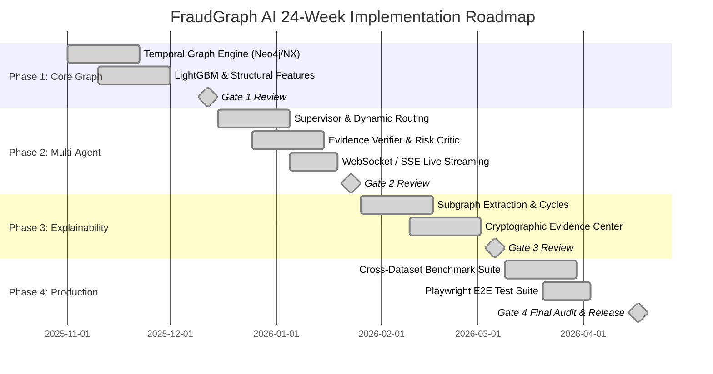

# FraudGraph AI — Engineering & Research Roadmap (2025–2026)

This document tracks the technical milestones, research deliverables, and active GitHub Issues governing the 24-week delivery of FraudGraph AI across its four architectural gates.

---

## 🗺️ Milestone & Sprint Overview

---

## 🏛️ Architecture Decision Records (ADRs)

| ADR | Title | Status | Scope |
| :--- | :--- | :--- | :--- |
| **[ADR-001](adr/0001-hybrid-networkx-and-neo4j-dual-engine.md)** | Hybrid NetworkX In-Memory & Neo4j Dual Engine | `Accepted` | Graph Engine |
| **[ADR-002](adr/0002-dynamic-agent-supervisor-and-budgeting.md)** | Dynamic 36-Agent Supervisor Routing with Budget Constraints | `Accepted` | Agentic AI (RQ-05) |
| **[ADR-003](adr/0003-anti-hallucination-and-devils-advocate.md)** | Anti-Hallucination Evidence Verifier & Devil's Advocate Protocol | `Accepted` | Agentic AI (RQ-01, RQ-04) |
| **[ADR-004](adr/0004-cryptographic-sha256-evidence-vault.md)** | Cryptographic SHA-256 Tamper-Evident Evidence Vault & SAR XML Export | `Accepted` | Compliance & Auditing |
| **[ADR-005](adr/0005-real-time-sse-trace-streaming.md)** | Server-Sent Events (SSE) for Real-Time Multi-Agent Trace Streaming | `Accepted` | Real-Time Streaming |

---

## 📍 Active GitHub Milestones & Issues

### Milestone 1: Phase 1 — Foundations & Core Graph Engine (Weeks 1–6)
*Goal: Scalable temporal graph storage, data ingestion pipelines, and tabular baseline models.*

| Issue | Title | Labels | Target Deliverable |
| :--- | :--- | :--- | :--- |
| **[#1](https://github.com/fraudgraph-ai/fraudgraph/issues/1)** | `[Epic] Temporal Graph Storage & Stream Ingestion Pipeline (Neo4j & NetworkX)` | `kind/epic`, `area/graph-engine`, `priority/p1-high` | Dual backend graph engine, temporal snapshotting, cycle algorithms |
| **[#2](https://github.com/fraudgraph-ai/fraudgraph/issues/2)** | `[Detection] Graph Feature Store & LightGBM Baseline Benchmark (RQ-02)` | `kind/feature`, `area/detection-ml`, `priority/p1-high` | Topological features, PR-AUC baseline on AMLSim and Elliptic++ |

**Gate 1 Exit Criteria:**
- Ingestion throughput ≥ 10,000 transactions/sec.
- No temporal leakage between training snapshots and forward evaluation windows.
- LightGBM baseline achieves PR-AUC ≥ 0.82.

---

### Milestone 2: Phase 2 — Multi-Agent Orchestration Engine (Weeks 7–12)
*Goal: Dynamic 36-agent execution, anti-hallucination verification, and real-time streaming.*

| Issue | Title | Labels | Target Deliverable |
| :--- | :--- | :--- | :--- |
| **[#3](https://github.com/fraudgraph-ai/fraudgraph/issues/3)** | `[Epic] 36-Agent Dynamic Routing & Supervisor Orchestration Engine (RQ-05)` | `kind/epic`, `area/agentic-orchestration`, `priority/p1-high` | Supervisor DAG planner, typology classification, token budget governor |
| **[#4](https://github.com/fraudgraph-ai/fraudgraph/issues/4)** | `[Agentic AI] Evidence Verifier & Risk Critic Protocol with Anti-Hallucination Guardrails (RQ-01, RQ-04)` | `kind/feature`, `area/agentic-orchestration`, `priority/p0-critical` | Independent fact-checking against graph nodes, counter-evidence evaluation |
| **[#5](https://github.com/fraudgraph-ai/fraudgraph/issues/5)** | `[Streaming] Real-Time Agent Trace Streaming Protocol (WebSocket / SSE)` | `kind/feature`, `area/frontend`, `priority/p2-medium` | Low-latency SSE telemetry, live trace terminal in Agent Operations module |

**Gate 2 Exit Criteria:**
- Dynamic routing cuts average investigation latency to ≤ 3.4 seconds (RQ-05).
- 100% of claims in finalized case dossiers cite verified transaction or entity IDs (RQ-01, RQ-04).
- Zero deadlock states under concurrent agent execution.

---

### Milestone 3: Phase 3 — Explainability & Case Management (Weeks 13–18)
*Goal: Explainable subgraph extraction, cryptographic evidence trails, and human-in-the-loop triage.*

| Issue | Title | Labels | Target Deliverable |
| :--- | :--- | :--- | :--- |
| **[#6](https://github.com/fraudgraph-ai/fraudgraph/issues/6)** | `[Explainability] Subgraph Extraction & Path-Based Explainability Engine (GNNExplainer & Cycles) (RQ-08)` | `kind/feature`, `area/detection-ml`, `priority/p1-high` | Minimal k-hop subgraph pruning, circular flow highlighting |
| **[#7](https://github.com/fraudgraph-ai/fraudgraph/issues/7)** | `[Compliance] Cryptographic Evidence Center with SHA-256 Audit Trail & SAR Auto-Dossier` | `kind/feature`, `area/case-management`, `priority/p1-high` | Immutability evidence vault, FinCEN/MAS SAR export, four-eye review |

**Gate 3 Exit Criteria:**
- Extracted subgraphs contain ≤ 15 critical nodes while retaining 95% of model attribution.
- Cryptographic SHA-256 verification of all uploaded evidence documents.
- Full audit replay capability for institutional and regulatory reviews.

---

### Milestone 4: Phase 4 — Enterprise Production Hardening & Benchmarking (Weeks 19–24)
*Goal: Cross-dataset empirical validation, automated testing, and production deployment.*

| Issue | Title | Labels | Target Deliverable |
| :--- | :--- | :--- | :--- |
| **[#8](https://github.com/fraudgraph-ai/fraudgraph/issues/8)** | `[Benchmark] Cross-Dataset Empirical Evaluation & Generalization Leaderboard (RQ-07)` | `kind/research-rq`, `area/detection-ml`, `priority/p1-high` | TransXion vs Elliptic++ vs AMLSim generalization benchmarks |
| **[#9](https://github.com/fraudgraph-ai/fraudgraph/issues/9)** | `[QA/Testing] Playwright End-to-End Automated Test Suite for All 12 Platform Modules` | `kind/feature`, `area/frontend`, `priority/p2-medium` | End-to-end browser test automation, visual regression testing |

**Gate 4 Exit Criteria:**
- Generalization score across synthetic and real-world generators drops by < 12% PR-AUC (RQ-07).
- 100% Playwright test pass rate across all 12 modules on CI/CD.
- Zero open P0 or P1 security issues.

---

## 🏷️ Standard Issue Taxonomy & Label Guide

- **`area/*`**: Architectural layer (`area/graph-engine`, `area/agentic-orchestration`, `area/detection-ml`, `area/case-management`, `area/compliance`, `area/frontend`).
- **`priority/*`**: Urgency indicator (`priority/p0-critical`, `priority/p1-high`, `priority/p2-medium`, `priority/p3-low`).
- **`kind/*`**: Nature of contribution (`kind/epic`, `kind/feature`, `kind/bug`, `kind/research-rq`, `kind/security`).
- **`dataset/*`**: Domain relevance (`dataset/elliptic`, `dataset/amlsim`, `dataset/transxion`).
